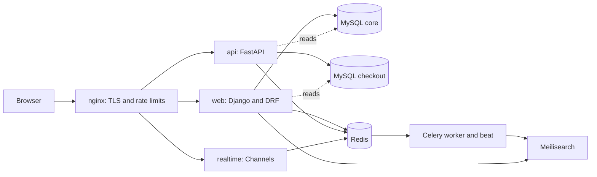

# TicketForge

TicketForge is an open-source event ticketing platform. Organizers set up venues, events and ticket types. Fans hold seats for ten minutes, pay, and get a signed QR ticket by email. Door staff scan those tickets with a phone camera or a handheld scanner.

It is built around the parts of ticketing that break under load: two people clicking the same seat in the same millisecond, a payment webhook that arrives twice or arrives late, a hold that expires while the card is being charged, and a ticket that gets scanned twice at two different doors. Each of those cases has a test that reproduces it.

The stack is Django 6.1 with Django REST Framework, FastAPI with SQLAlchemy 2, Django Channels, Celery, MySQL 8, Redis, Meilisearch and nginx, all started by one `docker compose` command.

## Contents

- [Quick start](#quick-start)
- [What it does](#what-it-does)
- [How it is built](#how-it-is-built)
- [Using the API](#using-the-api)
- [Tests and quality gates](#tests-and-quality-gates)
- [Load test results](#load-test-results)
- [Configuration](#configuration)
- [Running it in production](#running-it-in-production)
- [Project layout](#project-layout)
- [Further reading](#further-reading)
- [License](#license)

## Quick start

You need Docker Desktop, or Docker Engine with Compose v2. Nothing else has to be installed on the host to run the app.

```bash
git clone https://github.com/i-wajidrashid/ticketforge.git
cd ticketforge
cp .env.example .env
docker compose up -d --build
docker compose exec web python manage.py seed_demo_data --orders 400
```

The first build takes a few minutes. When it finishes:

| URL | What it is |
|---|---|
| https://localhost | The site. The certificate is self-signed, so the browser warns once. |
| https://localhost/org/ | Organizer dashboard, refunds and the door scanner |
| https://localhost/api/docs | Public and checkout API (FastAPI, OpenAPI) |
| https://localhost/org/api/docs/ | Organizer API (DRF, drf-spectacular) |
| https://localhost/admin/ | Django admin. The path is set by `ADMIN_URL`. |
| http://localhost:8025 | Mailpit, which catches every email the app sends |

The seed command creates these accounts. All of them use the password `ticketforge123`.

| Role | Email |
|---|---|
| Organizer | `organizer@ticketforge.local` |
| Fans | `fan000@ticketforge.local` to `fan119@ticketforge.local` |

The admin needs a superuser of its own: `docker compose exec web python manage.py createsuperuser`.

Payments go through a deterministic fake Stripe gateway by default, so checkout works offline and without a Stripe account. Put a real `sk_test_` key in `.env` to use Stripe test mode instead (see [Configuration](#configuration)).

`make help` lists every shortcut (`make up`, `make seed`, `make logs`, `make test` and so on).

## What it does

**For fans**

- Sign up, verify the email address, log in, reset a forgotten password. After 5 failed logins in 15 minutes the account is locked for the rest of that window, whether the attempts came from one address or many.
- Browse and search events. Search runs on Meilisearch with typo tolerance and filters for city, category, date and price, and falls back to a database `LIKE` query if Meilisearch is down.
- Pick seats on a live seat map or choose a quantity of general admission tickets. When someone else takes a seat, it is marked as taken on every open seat map without a page refresh.
- Hold the selection for 10 minutes with a visible countdown, then pay.
- Get the tickets by email as a PDF with a QR code, and download them again from the account page.
- Request a refund, unless a ticket on the order has already been scanned at the door.

**For organizers**

- Create venues, sections and seats (one at a time or as a CSV upload), events and ticket types through the organizer API.
- Publish or cancel events. Cancelling refunds every paid order.
- See revenue, tickets sold, check-ins, a daily revenue chart and recent sales on the dashboard. New sales appear live.
- Approve or reject refund requests.
- Add door staff by email, and scan tickets at `/org/scan/` with the camera (where the browser supports `BarcodeDetector`) or a keyboard-wedge scanner.

**For operators**

- Structured JSON logs with a request id on every line.
- Liveness and readiness endpoints (`/api/v1/health`, `/api/v1/ready`, `/health/`).
- A Celery Beat schedule that releases expired holds every 30 seconds, reconciles payments with Stripe at 02:00, marks finished events every hour and sends event reminders at 09:00 local time.
- A Jupyter notebook with read-only SQL reports: sales by hour, sell-through, hold-to-order conversion, refunds, no-shows and price against sell-through.

## How it is built



There are two MySQL schemas and each has exactly one writer. Django owns `core` (users, venues, events, ticket types) and its migrations. FastAPI owns `checkout` (seat inventory, holds, orders, tickets, refunds, the webhook ledger) and Alembic migrates it. Each service reads the other's tables with plain SQL and never writes to them. [docs/ARCHITECTURE.md](docs/ARCHITECTURE.md) explains why, and walks through every request.

### A seat can only be sold once

Every seat change is a conditional `UPDATE`, and the number of rows it touched decides who won:

```sql
UPDATE event_seat
SET status = 'held', hold_id = :hold_id, version = version + 1
WHERE event_id = :event_id AND seat_id = :seat_id AND status = 'available';
```

One row updated means the seat is yours. Zero rows means someone else got there first: the whole hold rolls back and the API answers `409 SEAT_UNAVAILABLE`. Seats in a multi-seat hold are always updated in ascending id order, so two overlapping holds cannot deadlock. General admission uses the same pattern with `WHERE available >= :quantity`, backed by a `CHECK (available >= 0)` constraint.

`tests/test_concurrency.py` starts 50 threads that all try to hold the same seat at once and checks that exactly one succeeds. A second test does the same with 40 threads against a small general admission pool.

### Paying is safe to retry

| Step | What makes a repeat harmless |
|---|---|
| Starting a payment | The `Idempotency-Key` header is stored with a `UNIQUE` index and forwarded to Stripe. The same key returns the same order. |
| One order per hold | `orders.hold_id` is `UNIQUE`, so a hold can be paid once even with different keys. |
| Stripe webhooks | The event id is inserted into a ledger table with a `UNIQUE` index, in the same transaction as the order change. A duplicate delivery inserts nothing and does nothing. |
| Refunds | The Stripe refund id is `UNIQUE`, and refund states only move forward. |
| Background tasks | Tasks take ids, not objects, and run with `acks_late` so a crashed worker's task is redelivered. |

Stripe's own guidance is the basis for this: the [idempotent requests](https://docs.stripe.com/api/idempotent_requests) reference, and the [webhooks guide](https://docs.stripe.com/webhooks), which warns that the same event can be delivered more than once and that events can arrive out of order.

### A hold that expires while you pay

Holds last 10 minutes. Celery Beat releases expired ones every 30 seconds, and checkout checks the expiry again inside its own transaction, so a slow sweeper never lets an expired hold be charged. If a payment still succeeds after the hold ran out (the card took too long, say), the webhook handler tries to take the same seats again inside a savepoint. If they are still free the order goes through. If someone else bought them, the payment is refunded automatically and the customer gets an email explaining what happened.

## Using the API

This is a real session against the local stack, trimmed for length. The access token lasts 15 minutes and the refresh token 7 days.

```bash
# 1. Log in (Django issues the JWT that FastAPI accepts)
curl -sk https://localhost/accounts/api/token/ \
  -H 'Content-Type: application/json' \
  -d '{"email": "fan011@ticketforge.local", "password": "ticketforge123"}'
# {"access": "eyJ...", "refresh": "eyJ...", "token_type": "Bearer", "expires_in": 900, "user": {...}}

# 2. Hold two general admission tickets
curl -sk https://localhost/api/v1/holds \
  -H "Authorization: Bearer $ACCESS" -H 'Content-Type: application/json' \
  -d '{"event_id": 2, "ticket_type_id": 3, "quantity": 2}'
# {"id": "df59dad0-...", "status": "active", "seconds_left": 599, "total_cents": 7000, ...}

# A second hold on the same event is refused while the first is active
# {"error": {"code": "HOLD_EXISTS", "message": "You already have an active hold for this event.", "details": {}}}

# 3. Start the payment. Sending the same Idempotency-Key again returns the same order.
curl -sk -X POST https://localhost/api/v1/checkout/$HOLD_ID/pay \
  -H "Authorization: Bearer $ACCESS" -H "Idempotency-Key: $(uuidgen)"
# {"order_id": "3e5eb4bc-...", "payment_intent_id": "pi_fake_...", "amount_cents": 7000, "status": "pending"}

# 4. Local only: make the fake gateway send the "payment succeeded" webhook
curl -sk -X POST https://localhost/api/v1/dev/simulate-payment/$ORDER_ID \
  -H "Authorization: Bearer $ACCESS"
# {"status": "processed", "result": "fulfilled", "order_id": "3e5eb4bc-..."}

# 5. The order is paid and has two tickets
curl -sk https://localhost/api/v1/me/orders -H "Authorization: Bearer $ACCESS"
```

Seated events take `"seat_ids": [...]` instead of a quantity. Every error from either service, including unknown routes, has the same shape, `{"error": {"code", "message", "details"}}`. [docs/API.md](docs/API.md) lists every endpoint, every error code, and the organizer calls for creating and publishing an event.

## Tests and quality gates

```bash
make setup                                  # uv virtualenv with the dev dependencies
docker compose up -d mysql redis search     # the tests use real services
make check                                  # ruff, mypy and pytest with coverage
```

There are 227 tests. They run against real MySQL and Redis, not SQLite or mocks, because the locking behaviour being tested only exists in the real database. Coverage is 92% overall and 100% for the two files that matter most, `api/app/services/holds.py` and `api/app/services/payments.py`. The build fails below 85%.

What the suite covers:

- 50 threads racing for one seat, and 40 buyers racing for a general admission pool smaller than the crowd.
- A [Hypothesis](https://hypothesis.readthedocs.io/) property test that runs random sequences of hold, cancel and expire, then checks that every seat is in exactly one state, every held seat belongs to an active hold, and no user ends up with two active holds for one event.
- Webhook replays, out-of-order events, and a payment that lands after its hold expired.
- A second scan of the same ticket, which is rejected with the time of the first scan.
- JWT handling, organizer data scoping, venue edit rules and login throttling.
- WebSocket consumers: authentication, the countdown tick, broadcasts and hold ownership.
- The organizer figures, including an order with several tickets that must be counted once.
- Settings that refuse to start with development secrets when debug is off.
- A Content Security Policy that forbids inline code, plus a check that no template needs it.

CI (`.github/workflows/ci.yml`) runs ruff, mypy, a check that no Django migration or Alembic revision is missing, the full test suite with the coverage gate, `pip-audit`, and a Docker image build.

## Load test results

`locustfile.py` simulates fans browsing before a big on-sale: anonymous requests for the event list, event pages, seat maps and search, weighted 5:3:2:1, with each simulated user waiting 0.5 to 2 seconds between requests. Checkout is not part of it, because 500 buyers would sell out the demo venues in seconds and the test would then only measure "sold out". The race conditions in checkout are covered by the concurrency tests instead.

Measured on an Apple M2 MacBook Air (8 cores) with Docker given 8 CPUs and 8 GB of memory, and Locust running on the same machine:

| Run | Requests/s | Median | p95 | p99 | Failures |
|---|---|---|---|---|---|
| 500 users, 90 s | 379 | 9 ms | 84 ms | 250 ms | 0 |
| 1000 users, 4 Locust processes | 465 | 700 ms | 1.8 s | 2.5 s | 0 |

At 500 users the system is comfortable. At 1000 users it is saturated: the Docker VM tops out at roughly 290% CPU and requests queue. With this think time, 500 users can only generate about 400 requests per second, so the first row is close to the most that profile can ask for. Before the catalogue cache and the read-only seat map (see [docs/DECISIONS.md](docs/DECISIONS.md)) the same 500-user run managed about 250 requests per second with a p95 of 2.8 seconds.

To run it yourself:

```bash
make loadtest-on        # raise the per-IP edge limit, which a single-machine test would trip
make loadtest-headless  # 500 users for 90 seconds, prints the summary
make loadtest-off       # put the production limit back
```

The `loadtest-on` step matters. nginx allows 20 requests per second per IP address, and every Locust user comes from the same address, so without it most requests are rejected with `503` by design. See [docs/OPERATIONS.md](docs/OPERATIONS.md#load-testing) for details.

## Configuration

Everything is configured through environment variables, read from `.env` by Docker Compose. `.env.example` lists them with working local values. The ones you are most likely to change:

| Variable | Default | Purpose |
|---|---|---|
| `DJANGO_DEBUG` | `1` in `.env.example`, off if unset | Debug pages. With it off, Django refuses to start on development secrets. |
| `DJANGO_SECRET_KEY`, `JWT_SECRET`, `QR_SECRET` | development values | Sign sessions, API tokens and ticket QR codes. Use 32 random characters or more. |
| `DJANGO_ALLOWED_HOSTS`, `SITE_ORIGIN` | `localhost` | Your domain. `SITE_ORIGIN` is used in emails and the CORS allow-list. |
| `STRIPE_SECRET_KEY`, `STRIPE_WEBHOOK_SECRET` | placeholders | Stripe test mode keys. |
| `STRIPE_GATEWAY` | `auto` | `fake`, `live`, or `auto` (real Stripe only when a real-looking `sk_test_` key is set). |
| `TIME_ZONE` | `Asia/Karachi` | Time zone for showing times on tickets and in emails. Storage is always UTC. |
| `ADMIN_URL` | `admin/` | Path of the Django admin. |
| `HOLD_TTL_MINUTES` | `10` | How long a hold lasts. |
| `HOLD_RATE_LIMIT_PER_MINUTE` | `10` | Holds a user can create per minute. |
| `CATALOGUE_CACHE_SECONDS` | `5` | How long the API may serve the event list and event pages from memory. `0` turns it off. |
| `UVICORN_WORKERS`, `GUNICORN_WORKERS`, `CELERY_CONCURRENCY` | `4`, `3`, `4` | Process counts. |

## Running it in production

The repository ships a production overlay. Read [docs/OPERATIONS.md](docs/OPERATIONS.md) and [SECURITY.md](SECURITY.md) first; the short version is:

1. Generate new values for `DJANGO_SECRET_KEY`, `JWT_SECRET` and `QR_SECRET`, for example with `python -c "import secrets; print(secrets.token_urlsafe(48))"`.
2. Set `DJANGO_ALLOWED_HOSTS`, `SITE_ORIGIN`, real SMTP settings and real Stripe keys.
3. Mount a real certificate over the self-signed one that the nginx image generates at build time (see [docs/OPERATIONS.md](docs/OPERATIONS.md#tls-certificates)).
4. Start the stack with the overlay:

   ```bash
   docker compose -f docker-compose.yml -f docker-compose.prod.yml up -d --build
   ```

The overlay forces debug off for every Django process, stops publishing the MySQL, Redis, Meilisearch and Mailpit ports so only nginx is reachable from outside, and creates the database user without the extra rights the test suite needs. Because debug is off, the `migrate` step refuses to run on development secrets, and every other service waits for `migrate`, so a stack with default secrets does not come up at all. That is deliberate.

## Project layout

```
ticketforge/
├── web/                 Django: pages, admin, accounts, organizer API, WebSocket consumers
│   ├── accounts/        signup, login, JWT, throttling, the account page
│   ├── events/          events, ticket types, public pages, seed command
│   ├── venues/          venues, sections, seats
│   ├── organizers/      organizer API, dashboard, refunds, scanner page
│   ├── realtime/        Channels consumers for seat maps, holds and sales
│   ├── config/          settings, URLs, ASGI and WSGI, the error envelope
│   ├── templates/       server-rendered HTML
│   ├── static/          CSS and the small amount of JavaScript the pages need
│   └── tests/
├── api/                 FastAPI: catalogue, holds, checkout, webhooks, scanning
│   ├── app/routers/     HTTP endpoints
│   ├── app/services/    all business rules live here
│   ├── app/core_repo.py read-only SQL against the core schema
│   └── alembic/         migrations for the checkout schema
├── worker/              Celery app, tasks and the PDF ticket renderer
├── common/              code both services share: JWT and QR signing, env, search, logging
├── tests/               concurrency, property, payment, webhook and API tests
├── deploy/nginx/        TLS, proxying, WebSocket upgrade, rate limits
├── docker/              container entrypoint and the MySQL bootstrap script
├── notebooks/           sales_report.ipynb
├── docs/                architecture, API, operations and design decisions
├── docker-compose.yml   the whole system
├── docker-compose.prod.yml       production overlay
├── docker-compose.loadtest.yml   load test overlay
├── locustfile.py
└── Makefile
```

## Further reading

- [docs/ARCHITECTURE.md](docs/ARCHITECTURE.md): services, data ownership, every request flow, failure modes.
- [docs/API.md](docs/API.md): endpoints, authentication, error codes, worked examples.
- [docs/OPERATIONS.md](docs/OPERATIONS.md): deploying, migrations, backups, load testing, incidents, rotating secrets.
- [docs/DECISIONS.md](docs/DECISIONS.md): the design decisions, what each one costs, and the sources behind them.
- [CONTRIBUTING.md](CONTRIBUTING.md): development setup and the rules the codebase follows.
- [SECURITY.md](SECURITY.md): reporting vulnerabilities and hardening a deployment.
- [CHANGELOG.md](CHANGELOG.md): what changed between versions.

The sales report notebook runs against the seeded data:

```bash
uv run --with jupyter --with pandas --with matplotlib jupyter lab notebooks/sales_report.ipynb
```

## License

[MIT](LICENSE). The two bundled typefaces, Big Shoulders Display and Schibsted Grotesk, are under the SIL Open Font License 1.1; their license files are next to the fonts in `web/static/fonts/`.
