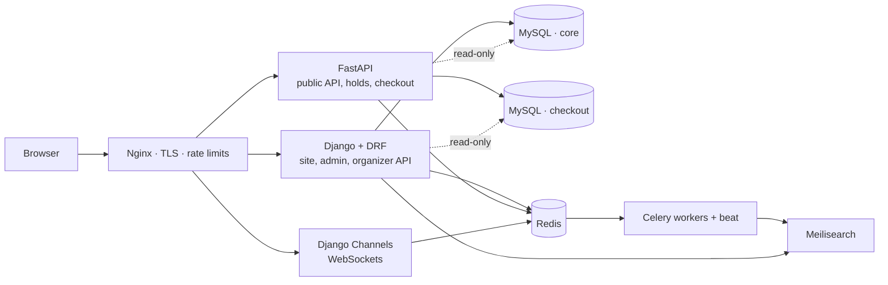

# TicketForge

A production-grade event ticketing platform: organizers create events and sell tickets,
customers reserve seats and pay, door staff scan signed QR tickets — and **nothing is ever
sold twice**, even with 50 browsers fighting over the same seat.

Built as a reference implementation of the hard parts of backend engineering: concurrency,
idempotent payments, background work, real-time updates, safe schema changes and automated
quality gates.

```
Django + DRF   FastAPI + SQLAlchemy 2   Django Channels   Celery   MySQL 8
Redis          Meilisearch             Nginx + TLS        Docker   pytest/Hypothesis
```

---

## Quick start

Prerequisites: Docker Desktop (or Docker Engine + Compose v2). Nothing else.

```bash
cp .env.example .env
docker compose up --build
```

| URL | What |
|---|---|
| <https://localhost> | The site (self-signed cert — your browser will warn once) |
| <https://localhost/api/docs> | FastAPI OpenAPI docs |
| <https://localhost/org/api/docs/> | Organizer API docs (DRF + drf-spectacular) |
| <https://localhost/admin/> | Django admin (`ADMIN_URL` is configurable) |
| <http://localhost:8025> | Mailpit — every email the app sends |
| <http://localhost:7700> | Meilisearch |

Seed a realistic dataset (events, customers, paid orders, refunds, check-ins):

```bash
docker compose exec web python manage.py seed_demo_data --orders 400
```

Demo logins (created by the seed command):

| Role | Email | Password |
|---|---|---|
| Organizer | `organizer@ticketforge.local` | `ticketforge123` |
| Customer | `fan000@ticketforge.local` … `fan119@…` | `ticketforge123` |

Payments run against a **deterministic fake Stripe gateway** out of the box, so checkout works
offline. Set a real `sk_test_…` key in `.env` to use Stripe test mode instead. The
`/api/v1/dev/simulate-payment/{order_id}` helper exists only while the fake gateway is active.

---

## What works

- **Accounts** — email signup, verification, login, password reset, JWT access (15 min) +
  refresh (7 days), rate-limited login (5 failures / 15 min per IP+account).
- **Events** — organizer CRUD, draft → published → on sale → finished/cancelled lifecycle,
  ticket types, general admission or reserved seating, cover images.
- **Search** — Meilisearch full text with typo tolerance, city/category/date/price filters and
  sorting; index updates are queued from Django signals on commit.
- **Checkout** — 10-minute holds, conditional-update seat locking, idempotent payments,
  Stripe webhook ledger, automatic late-payment refunds.
- **Tickets** — HMAC-signed QR tokens, PDF tickets emailed and downloadable, single scan.
- **Refunds** — customer request → organizer approve/reject → Stripe refund → seats returned.
- **Real time** — live seat maps, hold countdown, organizer sales counter over WebSockets.
- **Reports** — Jupyter notebook over read-only SQL (sales by hour, sell-through, drop-off,
  refunds, no-shows, price sensitivity).
- **Ops** — structured JSON logs with request ids, `/health` + `/ready`, Sentry-ready,
  Celery Beat schedule, dead-letter handling, zero-downtime migration guidance.

---

## Architecture



**Service ownership.** `core` is written only by Django (migrations own the schema). `checkout`
is written only by FastAPI (Alembic owns the schema). Each side reads the other's tables
read-only — one writer per table, two migration tools that never fight.

**Why two databases?** It forces the boundary that real teams need: the checkout path can scale
and deploy independently, and schema changes on one side cannot block the other. The full
rationale is in [`docs/ARCHITECTURE.md`](docs/ARCHITECTURE.md).

### The no-double-selling rule

Every seat transition is a conditional update; the affected-row count is the lock:

```sql
UPDATE event_seat
SET status = 'held', hold_id = :hold_id, version = version + 1
WHERE id = :seat_id AND status = 'available';
```

`rowcount == 1` → you own the seat. `rowcount == 0` → someone beat you, the whole hold rolls
back and the API returns `409 SeatUnavailable`. Multi-seat holds update seats in ascending id
order to avoid deadlocks. General admission uses the same trick with `available >= :qty`.

Proven by `tests/test_concurrency.py`: 50 threads, one seat, exactly one winner.

### Idempotency everywhere

| Layer | Mechanism |
|---|---|
| Payment start | `orders.idempotency_key` UNIQUE (also forwarded to Stripe) |
| Webhooks | `stripe_event.stripe_event_id` UNIQUE — the insert *is* the dedupe |
| Refunds | `refund.stripe_refund_id` UNIQUE + state machine |
| Tasks | IDs only, retry-safe, `acks_late` |

### Holds and expiry

Holds live 10 minutes. Celery Beat releases expired holds every 30 seconds **and** checkout
re-checks expiry before charging, so a slow sweeper can never charge for a lost seat. If a
payment succeeds after the seat was resold, the order is refunded automatically and the customer
gets an email.

---

## Quality gates

```bash
make test        # pytest (112 tests)
make lint        # ruff check + format check
make typecheck   # mypy (strict for api/common/worker, standard for web)
make coverage    # pytest --cov, fails under 85%
make check       # all of the above
```

What the suite covers:

- 50-thread concurrency races for seats and inventory;
- Hypothesis property test over random hold/cancel/expire histories;
- webhook replay, out-of-order and late-payment scenarios;
- double-scan rejection with the first scan timestamp;
- JWT auth, organizer object-scoping, rate limiting;
- WebSocket consumers (auth, ticks, broadcast, ownership);
- real MySQL/Redis/Meilisearch in every run — no SQLite shortcuts.

Current coverage: **86%+ overall**, `api/app/services/holds.py` 94%,
`api/app/services/payments.py` 88%. CI fails below 85%.

Static analysis: `ruff` (lint + format), `mypy` (strict on the service layer), `pre-commit`,
`pip-audit`, `makemigrations --check`, `alembic check`, and a Docker build on every PR.

---

## Load test

```bash
make loadtest   # locust -f locustfile.py --host https://localhost
# open http://localhost:8089, ramp to 500 users
```

---

## Report notebook

```bash
docker compose exec web python manage.py seed_demo_data --orders 800
uv run --with jupyter jupyter lab notebooks/sales_report.ipynb
```

The notebook connects read-only and answers: when do people buy, how fast events sell out,
hold → paid conversion, refund rate by category, no-show rate and price vs sell-through.

---

## Project layout

```
ticketforge/
├── web/                    # Django: site, admin, organizer API, Channels consumers
│   ├── accounts/ events/ venues/ organizers/ realtime/
│   ├── config/             # settings, urls, asgi, errors, context
│   ├── templates/ static/  # server-rendered UI + seat-map JS
│   └── tests/
├── api/                    # FastAPI: public API, holds, checkout, webhooks, scanning
│   ├── app/{routers,services,schemas,models,core_repo}
│   ├── alembic/            # owns the checkout schema
│   └── tests/              # shared suite lives in /tests
├── worker/                 # Celery app, tasks, PDF ticket rendering
├── common/                 # JWT/QR signing, env helpers, search, logging, realtime names
├── tests/                  # integration + property + concurrency tests
├── deploy/nginx/           # TLS, proxies, WebSocket upgrade
├── docker/                 # entrypoint + MySQL bootstrap
├── notebooks/              # sales_report.ipynb
├── docs/                   # architecture, operations, decisions
├── docker-compose.yml      # the whole system, one command
├── Dockerfile
├── pyproject.toml          # deps, ruff, mypy, pytest, coverage
├── locustfile.py
├── Makefile
└── .github/workflows/ci.yml
```

---

## Production notes

- Set real secrets (`DJANGO_SECRET_KEY`, `JWT_SECRET`, `QR_SECRET`, Stripe keys); never commit `.env`.
- Use managed MySQL/Redis or the provided containers with backups **and a tested restore**.
- Migrations run as a separate step before new code (the `migrate` service does exactly this).
  Schema changes follow expand → backfill → switch reads → contract.
- Nginx terminates TLS and applies a global rate limit; per-user limits live in Redis.
- Logs are JSON with a `request_id`; wire them to your aggregator and Sentry (`SENTRY_DSN` ready).
- `/health` is liveness, `/ready` checks MySQL + Redis.
- For a production-style start use the overlay:
  `docker compose -f docker-compose.yml -f docker-compose.prod.yml up -d`

---

## References

Design choices follow these well-established practices:

- [Stripe: idempotent requests](https://docs.stripe.com/api/idempotent_requests) and
  [webhook best practices](https://docs.stripe.com/webhooks#best-practices)
  (duplicate-safe consumers: [webhook replay handling](https://safeguard.sh/resources/blog/webhook-consumer-replay-and-duplicate-event-handling))
- [Django database transactions](https://docs.djangoproject.com/en/stable/topics/db/transactions/)
- [Django Channels deployment](https://channels.readthedocs.io/en/stable/deployment.html)
- [SQLAlchemy 2.0 ORM](https://docs.sqlalchemy.org/en/20/orm/)
- [Meilisearch filtering & sorting](https://www.meilisearch.com/docs/learn/filtering_and_sorting/filter_search_results)
- [Hypothesis](https://hypothesis.readthedocs.io/) for property-based testing of the invariants
- [The Twelve-Factor App](https://12factor.net/) for configuration and process model

---

## License

MIT. Have fun.
